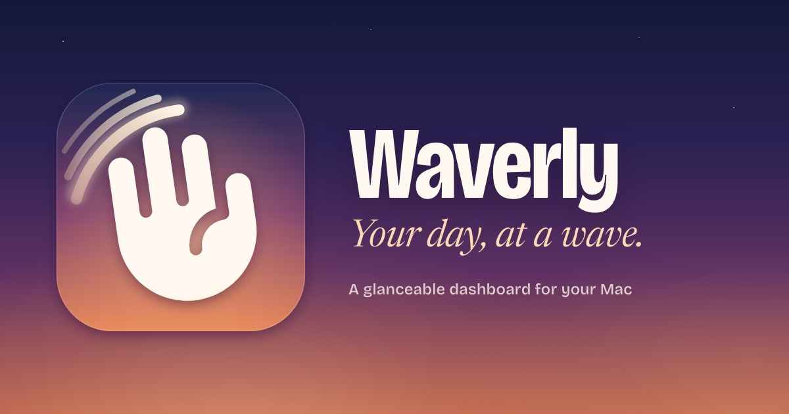

# Waverly



Waverly is a full-screen dashboard for your Mac that appears when you wave at the camera.
Your day fades in over whatever you were doing: the time, your Google Calendar events and
tasks, the hourly weather, and a word and fact of the day, on glass cards over a sky that
follows the real time and weather. Close your hand, press Esc or walk away, and it's gone.
The camera is processed on your Mac and never recorded or sent anywhere.

Website: [getwaverly.app](https://getwaverly.app) ·
Download: [latest release](https://github.com/LurpDaDerp/Waverly/releases/latest)

## Features

- **Hands-free:** open with a wave or a fist then an open hand, scroll by moving your open
  hand, close with a fist. It also closes a few seconds after you leave or the room goes dark.
- **Your day:** two lists you configure (by default Google Calendar events and Google
  Tasks) with countdowns, keyword filters and coloured labels. Click a task's ring to
  check it off in Google Tasks; click again within a few seconds to undo.
- **Weather and sky:** current conditions and an hourly forecast from Open-Meteo, over an
  animated sky with clouds, rain, snow, fog and storms.
- **Something to read:** Merriam-Webster's word of the day and a Wikipedia "Did you know" fact.
- **Yours to tune:** theme, open and close animations, parallax (the cards lean as your
  head moves), weather detail, hand-scroll direction and speed, which gestures are on,
  and the keyboard shortcut (default **fn ⇧ H**).
- **Light on battery:** hand tracking only runs while a hand is in view.
- **Private:** no accounts, servers or analytics.

## Requirements

- macOS 14 Sonoma or later on Apple silicon (MediaPipe has no Intel macOS build)
- A camera
- Internet for the one-time setup download (about 250 MB) and for weather, calendar,
  word and fact

## Install

1. Download `Waverly-<version>.dmg` from the
   [latest release](https://github.com/LurpDaDerp/Waverly/releases/latest) and drag
   **Waverly** to **Applications**.
2. Open it. Waverly isn't notarized yet, so the first time macOS blocks it: open
   **System Settings › Privacy & Security**, click **Open Anyway** next to the message about
   Waverly, and confirm.
3. Follow the setup window: your name, permissions (Camera for gestures, Accessibility for
   the keyboard shortcut in every app, Location for local weather; each optional),
   preferences, and Google sign-in (optional). Meanwhile Waverly downloads its
   hand-tracking engine into `~/Library/Application Support/Waverly`.

Waverly lives in the menu bar: Show / Hide Waverly, Pause camera, Connect Google Calendar…,
Settings…, Open logs, Launch at login, Quit Waverly.

## Using it

| To | Gesture | Keyboard / trackpad |
|---|---|---|
| Open | Sweep your open hand once across the camera's view, palm toward it; or make a fist, then open your hand toward the camera | The shortcut |
| Scroll | Hold your hand open and move it: up / down scrolls a list (left hand: left list, right hand: right list), sideways scrolls the hourly forecast | Two fingers on the trackpad |
| Close | Hold up an open palm, then close it into a fist; or walk away; or turn off the light | The shortcut, or **Esc** |

Opening only counts with your palm toward the camera, so scratching your head or showing
the back of your hand doesn't open it. Each gesture can be turned off in **Settings ›
Controls**; with both open gestures off, only the shortcut and the menu open Waverly.

**Settings** (menu bar › Settings…, changes apply at once):

- **General:** name, location (automatic or a city), launch at login.
- **Appearance:** theme (Adaptive, Light, Dark), units, 12/24-hour clock, parallax,
  weather animation and detail, and the open and close animation (Fade, Zoom, Shatter,
  Slide, Swirl) and length.
- **Controls:** keyboard shortcut, which gestures open and close Waverly, hand-scroll
  direction and speed.
- **Lists:** each list's title, sources, keyword filters, look-ahead and countdowns.
- **Labels:** colours for calendars and task lists, and shared categories.
- **Google:** connect, reconnect or disconnect; under Advanced, your own OAuth client.
- **Permissions:** camera, Accessibility and location.

Settings live in `~/Library/Application Support/Waverly/config.json`.

## Privacy

- Camera frames are analysed on your Mac (Apple Vision and MediaPipe), never recorded or
  sent. Frames reach the hand-tracking engine through a shared-memory file readable only
  by you, wiped when the camera stops and deleted when Waverly quits.
- Key presses are checked only for the shortcut and Esc.
- Google: read-only for calendars (`calendar.readonly`); for tasks (`tasks`) the only
  change Waverly makes is marking one done when you check it off. Tokens stay on your Mac.
- Your location is rounded to about 10 km before it goes to Open-Meteo.

Full policy: [getwaverly.app/privacy](https://getwaverly.app/privacy).

## Google Calendar

Choose **Connect Google Calendar…** from the menu (or **Settings › Google**) and sign in in
your browser. Until Google verifies the app, sign-in shows **"Google hasn't verified this
app"**: click **Advanced › Go to Waverly (unsafe)**. To disconnect, use **Settings › Google ›
Disconnect**.

**Builds from source** need their own OAuth client:

1. In the [Google Cloud console](https://console.cloud.google.com/), create a project and
   enable the **Google Calendar API** and **Google Tasks API**.
2. Set up the OAuth consent screen: External audience, scopes
   `https://www.googleapis.com/auth/calendar.readonly` and
   `https://www.googleapis.com/auth/tasks`, a privacy policy URL, and publish it **In
   production** (in testing, access expires after 7 days).
3. Create an OAuth client ID of type **Desktop app**, then either pick its JSON in
   **Settings › Google › Advanced › Choose Client File…**, or build it in:

   ```sh
   cp macos/Config/Secrets.example.xcconfig macos/Config/Secrets.xcconfig
   # set GOOGLE_CLIENT_ID and GOOGLE_CLIENT_SECRET (no quotes); the file is git-ignored
   ```

   `scripts/build.sh` ends with "built-in Google client" when it's picked up.

## Building from source

Needs Xcode 16 or later on Apple silicon.

```sh
scripts/build.sh        # Release build -> build/Waverly.app (ad-hoc signed; fetches uv if missing)
scripts/verify.sh       # signature, bundled runtime, tests (uses the app's Python: open Waverly once first)
scripts/make_dmg.sh     # -> dist/Waverly-<version>.dmg
```

`build.sh` regenerates `Waverly.xcodeproj` and copies `hud/` into the app unchanged. Edit
`hud/` and rebuild; never edit the copy inside `build/Waverly.app`. To ship without the
Open Anyway step, sign with a Developer ID and notarize:

```sh
xcrun notarytool store-credentials Waverly --apple-id you@example.com --team-id TEAMID --password <app-specific password>
SIGN_IDENTITY="Developer ID Application: Your Name (TEAMID)" scripts/notarize.sh
```

## How it works

- **Waverly.app** (Swift, `macos/Sources`) owns the camera, menu bar, overlay window,
  setup and Settings, Google sign-in and `config.json`, and supervises two Python helpers.
- **hud-engine** (`hud/python/hud/engine.py`, `gestures.py`) reads frames from a
  shared-memory ring, runs MediaPipe and turns hand movement into gestures. It owns the
  dashboard's state; the app shows and hides the overlay on its request.
- **hud-core** (`hud/python/hud/core.py`, on `127.0.0.1:47780`) serves the page, fetches
  weather, Google data, the word and the fact, and relays messages.
- **The page** (`hud/ui`) draws the cards and sky in a panel above every window.

While Waverly is closed, MediaPipe doesn't run: the camera samples 5 frames a second, and
Apple Vision looks for a hand only when something moves. A clear hand switches to 30 fps
for the engine, which lets go about 1.5 s after the hand is still or gone. The camera
pauses while the screen is locked or the Mac sleeps (and, on battery, while the display
sleeps).

```
macos/Sources/   the Swift app          hud/python/hud/  hud-core, hud-engine, gestures
macos/Config/    Info.plist, xcconfig   hud/ui/          the page
hud/tests/       tests                  hud/tools/       replay_video.py, fake_app.py, fake_camera.py
docs/            the website            scripts/         build, verify, DMG, notarize, icons
```

## Tests and debugging

```sh
PY="$HOME/Library/Application Support/Waverly/venv/bin/python"
cd hud && for t in tests/test_*.py; do "$PY" "$t" | tail -1; done   # page tests need Google Chrome
HUD_MODELS="$PWD/models" "$PY" tools/replay_video.py clip.mov --asleep   # gestures in a recorded clip
```

Launch switches (`open -n build/Waverly.app --args …`): `-HUDDebugSocket PATH` (a control
socket; commands in `macos/Sources/DebugControl.swift`), `-HUDTestVideo PATH` (a video
instead of the camera), `-HUDVerboseGate YES`, `-HUDPageQuery "mac=1&demo=1"`,
`-HUDShowOnLaunch YES`, `-HUDNoHelpers YES`.

## Troubleshooting

- **Logs:** menu bar › Open logs, or `~/Library/Logs/Waverly` (`app.log`, `core.log`,
  `engine.log`). The engine logs every wake decision.
- **Shortcut does nothing:** allow Waverly under **Privacy & Security › Accessibility**.
- **Gestures do nothing:** allow the camera, check it isn't paused in the menu, and face
  your palm to it.
- **Permissions lost after a build of your own:** each ad-hoc build looks like a new app;
  toggle Waverly's Camera and Accessibility switches off and on.
- **Start over:** quit Waverly and delete `~/Library/Application Support/Waverly` (about
  380 MB); setup runs again on the next launch.
- **Uninstall:** disconnect Google in Settings, quit, delete the app,
  `~/Library/Application Support/Waverly`, `~/Library/Caches/Waverly`,
  `~/Library/Logs/Waverly` and `~/Library/Preferences/app.waverly.Waverly.plist`, then run
  `tccutil reset All app.waverly.Waverly`.

## Credits and license

Hand icon: Phosphor Icons (MIT). Type: Bricolage Grotesque and Newsreader (OFL 1.1). Hand
tracking: [MediaPipe](https://github.com/google-ai-edge/mediapipe) (Apache 2.0) and Apple
Vision. Weather: [Open-Meteo.com](https://open-meteo.com/) (CC BY 4.0). Word of the day:
Merriam-Webster. Fact: Wikipedia. Setup: [uv](https://github.com/astral-sh/uv) by Astral.

Waverly is released under the [MIT License](LICENSE). Copyright (c) 2026 LurpDaDerp.
Included third-party parts keep their own licences: see
[THIRD_PARTY_NOTICES.md](THIRD_PARTY_NOTICES.md).
